<!--
  SHARON K DAVASIA · PROFILE IDENTITY
  Minimal editorial / sage & neutral / GitHub-native Markdown + HTML.

  Edit checklist
  · Replace the [ADD CREDENTIAL URL] placeholders below with public proof links.
  · Confirm résumé-derived experience and recognition before publishing.
  · Add project demo links only after verifying a real deployment.
  · Skills are an editable working inventory, not proficiency ratings.
  · Sources, maintenance notes, and external-service checks: docs/PROFILE_NOTES.md.
-->

<picture>
  <source media="(prefers-color-scheme: dark)" srcset="assets/header-dark.svg" />
  <source media="(prefers-color-scheme: light)" srcset="assets/header-light.svg" />
  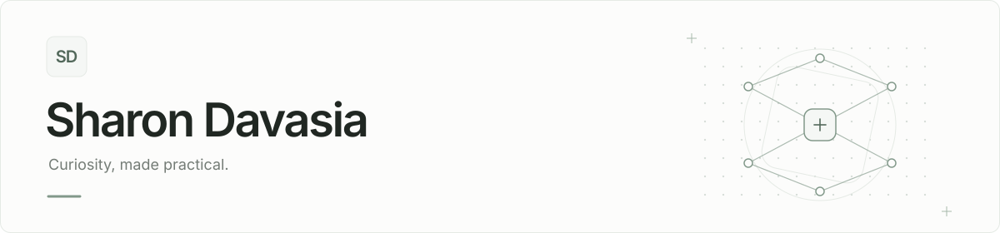
</picture>

  <h3>Sharon K Davasia</h3>
  
<strong>Computer Science Student | AI &amp; ML Enthusiast | Full-Stack Developer</strong>

I explore the space between intelligent models and well-crafted software. My projects range from AI-assisted knowledge tools to full-stack applications and computer-vision experiments — with a preference for ideas that become useful, working things.

## 01 / About me

- Pursuing **B.Tech in Computer Science, specializing in AI, ML, and Deep Learning** at Teerthanker Mahaveer University.
- Exploring artificial intelligence and deep learning through practical, hands-on projects.
- Interested in full-stack development, software engineering, and the systems around a model.
- Building applications, experimenting with emerging technologies, and continuously refining my skills.

*I like the moment an experiment becomes something someone can actually use.*

## 02 / Technical arsenal

A working toolkit, not a proficiency scoreboard.

<!-- Edit a group by adding/removing one  line. Icons are local, transparent SVGs. -->
<table>
  <tr>
    <td width="27%"><strong>Programming languages</strong></td>
    <td>
      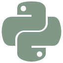
      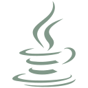
      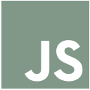
      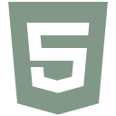
      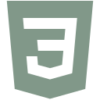
    </td>
  </tr>
  <tr>
    <td><strong>Frontend development</strong></td>
    <td>
      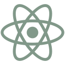
      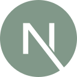
      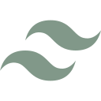
    </td>
  </tr>
  <tr>
    <td><strong>Backend development</strong></td>
    <td>
      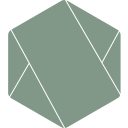
      
      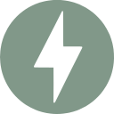
      
    </td>
  </tr>
  <tr>
    <td><strong>AI &amp; machine learning</strong></td>
    <td>
      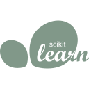
      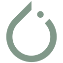
      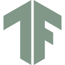
      
      
       RAG · Prompt engineering
    </td>
  </tr>
  <tr>
    <td><strong>Databases &amp; infrastructure</strong></td>
    <td>
      
      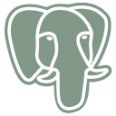
      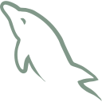
      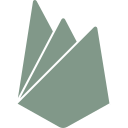
      
      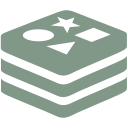
    </td>
  </tr>
  <tr>
    <td><strong>Developer tools</strong></td>
    <td>
      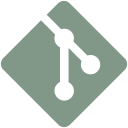
      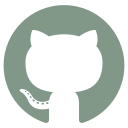
      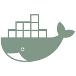
      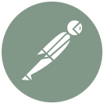
      
    </td>
  </tr>
</table>

## 03 / Selected work

A few projects across applied AI, computer vision, and full-stack engineering.

<!-- Artwork is original and decorative, not a screenshot or a claim about deployment. -->
<table>
  <tr>
    <td width="30%" valign="middle"><picture>
        <source media="(prefers-color-scheme: dark)" srcset="assets/projects/recallpad-dark.svg" />
        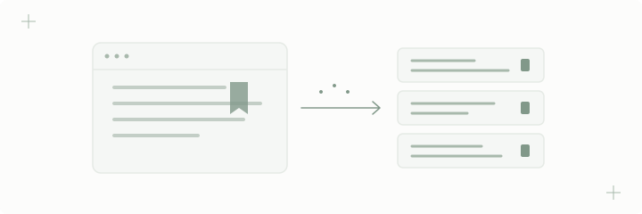
      </picture></td>
    <td width="70%" valign="top"><h3><a href="https://github.com/Sharon-Davasia/Google-Chrome-Built-in-AI-Challenge">RecallPad</a></h3>
      Applied AI · Chrome extension
      
Capture web text, summarize it, and search your saved knowledge from a Chrome extension.

      
JavaScript · Chrome APIs · OpenAI API

      <a href="https://github.com/Sharon-Davasia/Google-Chrome-Built-in-AI-Challenge">View repository ↗</a>
      <!-- Live demo: [ADD VERIFIED URL WHEN AVAILABLE] -->
    </td>
  </tr>
  <tr>
    <td width="30%" valign="middle"><picture>
        <source media="(prefers-color-scheme: dark)" srcset="assets/projects/ideaforge-dark.svg" />
        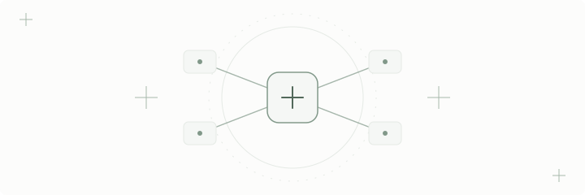
      </picture></td>
    <td width="70%" valign="top"><h3><a href="https://github.com/Sharon-Davasia/ideaforge-hackathon">IdeaForge</a></h3>
      Multi-agent AI · Hackathon
      
A hackathon experiment in coordinated agents that turn an idea into validation, architecture, planning, and documentation.

      
IBM watsonx Orchestrate · Granite

      <a href="https://github.com/Sharon-Davasia/ideaforge-hackathon">View repository ↗</a>
      <!-- Live demo: [ADD VERIFIED URL WHEN AVAILABLE] -->
    </td>
  </tr>
  <tr>
    <td width="30%" valign="middle"><picture>
        <source media="(prefers-color-scheme: dark)" srcset="assets/projects/certifypro-dark.svg" />
        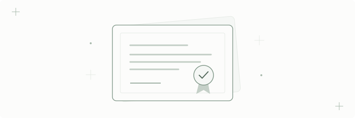
      </picture></td>
    <td width="70%" valign="top"><h3><a href="https://github.com/Sharon-Davasia/Cathedral">CertifyPro</a></h3>
      Full-stack · Certificate management
      
Manage certificate templates, role-based access, PDF generation, and CSV-driven bulk issuance.

      
React · Node.js · Express.js · MongoDB

      <a href="https://github.com/Sharon-Davasia/Cathedral">View repository ↗</a>
      <!-- Live demo: [ADD VERIFIED URL WHEN AVAILABLE] -->
    </td>
  </tr>
  <tr>
    <td width="30%" valign="middle"><picture>
        <source media="(prefers-color-scheme: dark)" srcset="assets/projects/vision-dark.svg" />
        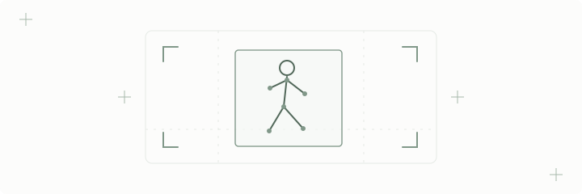
      </picture></td>
    <td width="70%" valign="top"><h3><a href="https://github.com/Sharon-Davasia/Uptoskills_Output_Repo">Vision experiments</a></h3>
      Computer vision · Team repository
      
Shared internship work on road-defect, fire/smoke, perimeter, and fall detection, with notebooks and outputs.

      
Python · OpenCV · PyTorch · YOLO

      <a href="https://github.com/Sharon-Davasia/Uptoskills_Output_Repo">View repository ↗</a>
      <!-- Live demo: [ADD VERIFIED URL WHEN AVAILABLE] -->
    </td>
  </tr>
</table>

  
One more practical experiment

   
  <a href="https://github.com/Sharon-Davasia/Kiro-week2"><strong>Downloads Folder Organizer</strong></a> — a Python utility for sorting files by type, with dry-run previews, logging, and undo support.

## 04 / GitHub activity

<!-- One live widget only. The native GitHub link below remains useful if the service fails. -->
<picture>
  <source media="(prefers-color-scheme: dark)" srcset="https://streak-stats.demolab.com/?user=Sharon-Davasia&amp;background=161C18&amp;border=303B33&amp;stroke=303B33&amp;ring=819889&amp;fire=819889&amp;currStreakNum=E6ECE7&amp;sideNums=E6ECE7&amp;currStreakLabel=B7C8BC&amp;sideLabels=B7C8BC&amp;dates=A4AEA6&amp;border_radius=6&amp;disable_animations=true" />
  
</picture>

Public contributions, rendered live. <a href="https://github.com/Sharon-Davasia?tab=overview">Open the native activity overview ↗</a>

## 05 / Currently exploring

- **Deep learning** — architectures, training choices, and computer-vision workflows.
- **AI-powered applications** — retrieval, evaluation, and interfaces that keep people in control.
- **Engineering depth** — scalable backend patterns and modern frontend development.

## 06 / Experience & milestones

<!-- Transcribed from the published résumé linked below. Confirm current roles/dates. -->
| Experience | Focus |
| --- | --- |
| **Deep Learning Intern · Uptoskills** | Computer-vision pipelines for surveillance and anomaly detection. |
| **Business Intelligence Intern · Microsoft Elevate / AICTE** | Power BI dashboards for sales and public-health data. |
| **Web Development Assistant · Anant Webtics** | Project-based work on a library-management application. |

**Recognition** — Best Project Award, TMU Internal Hackathon, for a blood-donation platform. 
**Leadership** — Class Representative for two semesters.

  
Certifications

   
  <ul>
    <li>AWS Academy Graduate — Generative AI Foundations · </li>
    <li>Oracle Cloud Infrastructure 2025 — Generative AI Professional · </li>
    <li>MongoDB — RAG, Advanced Schema Patterns and Anti-patterns · </li>
    <li>Microsoft Elevate / AICTE — Power BI Internship Certification ·</li>
  </ul>
  Titles transcribed from the <a href="https://github.com/Sharon-Davasia/dispensable_portfolio1/blob/main/SHARON_RESUME_LATEST.pdf">published résumé</a>; public verification links are not yet supplied.

## 07 / Let's connect

<!-- Local SVG badges keep the closing section readable even if a badge service is down. -->

  <a href="https://github.com/Sharon-Davasia"><picture><source media="(prefers-color-scheme: dark)" srcset="assets/contact/github-dark.svg" /></picture></a>
  <a href="https://linkedin.com/in/sharon-k-davasia-432080307"><picture><source media="(prefers-color-scheme: dark)" srcset="assets/contact/linkedin-dark.svg" /></picture></a>
  <a href="mailto:davasiasharon@gmail.com"><picture><source media="(prefers-color-scheme: dark)" srcset="assets/contact/email-dark.svg" /></picture></a>
  <a href="https://sharonportfolio0.vercel.app"><picture><source media="(prefers-color-scheme: dark)" srcset="assets/contact/portfolio-dark.svg" />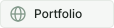</picture></a>

**Always learning. Always building. Open to meaningful collaborations.**

<!-- Contact details come from the public portfolio/résumé. Replace or remove any you prefer not to display. -->
